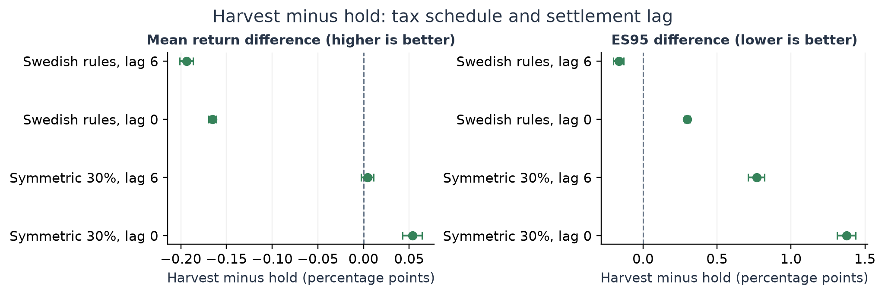
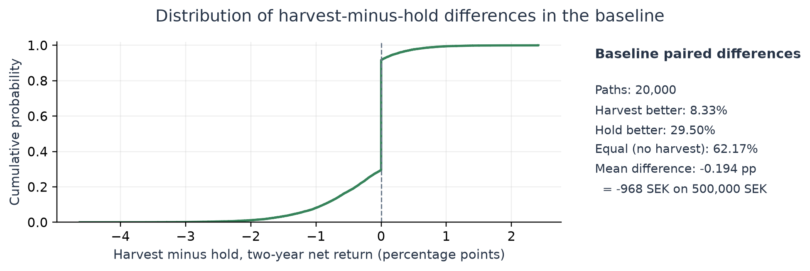
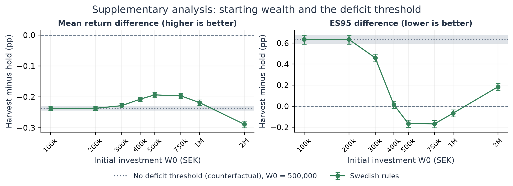
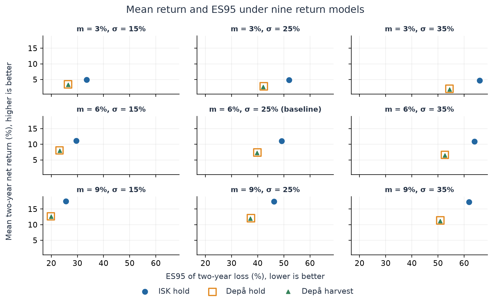

# One loss realization, two tax years

**Love Vaishnav** | 2026-10-14

Does realizing a loss once, at month 12, and investing the resulting tax relief when it is received, change the two-year mean net return or the tail loss of a Swedish depå investment? The study compares that policy with holding in the depå and with holding in an investment savings account (ISK). The question is taken from the project “Analyzing risk and return of Swedish investment vehicles” in Umeå University’s internship project list [U1]; this is an independent study, not supervised by or affiliated with Umeå University.

**Strategies.** I = ISK hold; D = depå hold; H = depå harvest, which sells and immediately repurchases the whole position once, at month 12, if net sale proceeds are more than 5% below acquisition cost. All positions are sold at month 24 and every assessed tax is then settled.

**Outcomes.** $W_0$ is the initial investment and $W$ the net investment outcome after all taxes are settled, less any external payments $F$ that the investor makes to cover a tax bill the account cannot pay. The two-year return is $r = W/W_0 - 1$ and the loss is $L = -r$. ES95 (expected shortfall at 95%) is the mean of the worst 5% probability mass of $L$. Returns are not annualized.

| Table 1. Baseline | Mean return, % [MC interval] | ES95 loss, % [MC interval] |
| --- | --- | --- |
| ISK hold | 11.010 [10.473, 11.559] | 49.165 [48.563, 49.763] |
| Depå hold | 7.438 [7.045, 7.841] | 39.855 [39.336, 40.372] |
| Depå harvest | 7.244 [6.850, 7.647] | 39.691 [39.177, 40.218] |

### Main results

**Mean return.** Harvesting lowers the baseline mean two-year return: harvest minus hold is -0.194 [-0.201, -0.186] percentage points (pp), about -968 SEK in mean final outcome on 500,000 SEK. Harvesting lowers the mean in 17 of the 17 configurations with Swedish tax rules, with every interval below zero. In the baseline, harvesting does better than holding on 8.33% of paths.

**Tail loss.** In the baseline, harvesting also lowers ES95: the difference is -0.164 [-0.202, -0.131] pp, about -820 SEK in monetary ES95. This is the difference between the two strategies’ tail averages, not the mean of paired differences. The ES95 effect changes with starting wealth, settlement timing, tax-reduction capacity and return parameters: across all 19 configurations the ES95 interval lies above zero (harvesting worse) in 10, below zero in 8 and includes zero in 1. The section on starting wealth and timing examines why.

**Accounts.** ISK holding has a higher mean return and a higher ES95 than either depå strategy. The depå’s lower tail loss assumes that each year’s tax reduction can be used in full; with zero capacity the H − I ES95 difference shrinks from -9.474 to -0.179 pp. Because every position is sold at month 24, the study does not capture the depå’s ability to defer gains tax.

MC = Monte Carlo. Brackets give approximate pointwise 95% MC intervals from 2,000 paired bootstrap draws; they measure simulation error conditional on the model. Negative ES95 differences (A minus B) mean lower tail loss for A.

## Model, tax rules and an analytical benchmark

**Prices.** 20,000 independent paths of 24 months. All strategies use the same price paths, and all configurations use the same standard-normal innovations $Z_t$, transformed with their own parameters. With $m$ the expected annual simple price return and $\sigma$ the annual volatility,

$$\log(S_t/S_{t-1}) = \frac{\log(1+m) - \sigma^2/2}{12} + \frac{\sigma Z_t}{\sqrt{12}}, \qquad E[S_{12}/S_0] = 1+m.$$

Baseline: $W_0 = 500{,}000$ SEK, $S_0 = 100$, $m = 6\%$, $\sigma = 25\%$, trading cost 0.1% per purchase or sale, six-month settlement lag, one non-dividend asset, fractional shares and no interest.

**Depå [S1–S3].** Gains and losses are netted within each tax year. A positive net gain is taxed at 30%. For a net loss, 70% forms a capital deficit D, and the tax reduction is 30% of D up to 100,000 SEK plus 21% of the excess, so residual raw losses receive 21% and then 14.7% relief. The threshold and the reduction capacity apply per individual taxpayer and per tax year; unused reductions are not carried forward. Acquisition cost includes purchase fees and follows the average-cost method; an eligible sale may instead deduct 20% of net proceeds, which does not change the acquisition cost of the remaining shares. In H, the sale is assumed to settle before the repurchase, so the repurchased shares get a new acquisition cost.

**ISK [S4].** With $Q_{yj}$ the account value at the start of quarter $j$ and $D_y$ the deposits in year $y$, the tax is $T_y = 0.01065\,\max(K_y - 300{,}000,\,0)$ with $K_y = (Q_{y1} + \dots + Q_{y4} + D_y)/4$. The rate is 30% of 3.55% (the government bond rate of 2.55% plus 1 percentage point). The 300,000 SEK allowance is assumed unused by other ISK, capital-insurance or PEPP savings. The ISK tax is paid by selling shares.

**Timing.** Taxes are assessed at months 12 and 24 and settled after a fixed lag of 0, 6 or 12 months. Using the same lag for bills and refunds is a modelling convention; actual payment dates depend on the final tax decision [S5]. Credits received before month 24 are invested immediately; later credits stay in cash. Both model years use the 2026 rules.

### Why a refund does not ensure a gain

Take one share with acquisition cost $b$, sold and repurchased at $p < b$ without costs. Let $d = b - p$, credit $R = \lambda d$ received when the price is $s$, terminal price $z \ge b$ and gains-tax rate $\tau$. Reinvesting gives $1 + R/s$ shares with acquisition cost $p + R$, and

$$W_D = (1-\tau)z + \tau b, \qquad W_H = (1-\tau)z(1+R/s) + \tau(p+R),$$

$$\Delta W = W_H - W_D = d\{\lambda[(1-\tau)z/s + \tau] - \tau\}.$$

This holds for $0 \le \lambda \le 1$, $0 \le \tau < 1$, $b \ge 0.2z$ and $p + R \ge 0.2z(1+R/s)$, with the loss and the final gain in different tax years. For $\lambda > 0$ harvesting breaks even at $z/s = \tau(1-\lambda)/[\lambda(1-\tau)]$; at $\lambda = 0.21$ and $\tau = 0.30$ this is $79/49 \approx 1.612$, a price ratio measured from the refund date. With symmetric relief ($\lambda = \tau$) the break-even ratio is 1.

| 100 → 80 → 100, no costs | Credit | Final acquisition cost | Gains tax | Final W |
| --- | --- | --- | --- | --- |
| 21% relief invested at 80 | 4.2 | 84.2 | 6.315 | 98.935 |
| 21% relief kept as cash | 4.2 | 80 | 6 | 98.200 |
| 30% relief invested at 80 | 6 | 86 | 6.45 | 101.050 |

Holding ends at 100 in all three cases. Harvesting lowers the acquisition cost, so the early credit must outweigh the later gains tax; with 21% relief and a 30% gains tax that requires the price to rise by more than about 61% after the refund. If the refund instead buys shares at 60, the first case ends at 100.16, so a later refund is not always worse.

## Simulated comparisons

*Figure 1. Harvest minus hold (pp) with pointwise 95% MC intervals, under Swedish rules and a counterfactual symmetric 30% schedule, with settlement lags of 6 and 0 months.* ([PDF version](../figures/figure1_tax_and_lag.pdf))

*Figure 2. Empirical distribution of all 20,000 baseline harvest-minus-hold return differences. Paths without a harvest give exactly zero.* ([PDF version](../figures/figure2_paired_difference.pdf))

| Table 2. Changed input | H − D mean / ES95, pp | H − I mean / ES95, pp | Harvests |
| --- | --- | --- | --- |
| Baseline | -0.194 / -0.164 | -3.765 / -9.474 | 37.83% |
| Cost 0 | -0.143 / -0.247 | -3.773 / -9.543 | 37.56% |
| Cost 0.25% per trade | -0.271 / -0.038 | -3.757 / -9.369 | 38.28% |
| Harvest threshold 0% | -0.214 / -0.162 | -3.786 / -9.472 | 46.00% |
| Harvest threshold 10% | -0.162 / -0.161 | -3.734 / -9.471 | 29.79% |
| W0 = 100,000 SEK | -0.237 / 0.634 | -4.688 / -9.621 | 37.83% |
| Tax-reduction capacity 0 | -0.782 / 0.153 | -6.259 / -0.179 | 37.83% |
| Settlement lag 12 months | -0.222 / -0.690 | -3.804 / -10.052 | 37.83% |

Table 2 changes one input at a time (intervals in tables/table2_sensitivity.md). Harvests occur on 37.83% of baseline paths; among those paths the mean H − D difference is -0.512 pp. The full results for all 19 configurations, with intervals, are in tables/scenario_metrics.csv and tables/contrasts.csv.

## Starting wealth, timing and the tail result

Per tax year, a capital deficit $D$ receives the reduction $R(D) = 0.21D + 0.09\min(D,\,100{,}000)$. Realizing part of a loss in year 1 and the rest in year 2 gives each part its own 100,000 SEK threshold. Compared with realizing the same total deficit in one year, the split can add at most $0.09 \times 100{,}000 = 9{,}000$ SEK of relief: 1.8% of 500,000 SEK but only 0.45% of 2,000,000 SEK. Without the threshold the reduction is proportional, every depå quantity scales with $W_0$, and the harvest-minus-hold comparison in percent does not depend on $W_0$.

*Figure 3. Supplementary analysis. Harvest minus hold (pp) for eight starting amounts under Swedish rules, with pointwise 95% MC intervals, and the counterfactual without the deficit threshold at W0 = 500,000 SEK (dotted line, shaded interval). Same 20,000 innovations and 2,000 bootstrap draws as the primary results.* ([PDF version](../figures/figure3_wealth_threshold.pdf))

**Starting wealth.** The supplementary experiments (Table S1) keep every baseline input except $W_0$. The H − D ES95 differences, in pp, are 0.634 (100k), 0.634 (200k), 0.460 (300k), 0.015 (400k), -0.164 (500k), -0.167 (750k), -0.066 (1M), 0.185 (2M). At 100,000 SEK the threshold cannot be reached (the deficit is at most 70% of $W_0$) and at 200,000 SEK only the most extreme paths reach it; at both, harvesting raises ES95 by the same amount as in the counterfactual below. At 300,000 SEK it still raises ES95; between about 500,000 and 1,000,000 SEK it lowers ES95; at 2,000,000 SEK harvesting raises ES95 again, consistent with the bounded extra relief being small relative to $W_0$. In the counterfactual without the threshold, the difference at 500,000 SEK is 0.634 pp [0.590, 0.675]. Removing the threshold changes the mean difference only from -0.194 to -0.237 pp.

**Reinvestment timing.** The settlement lag decides how much of the year-1 credit is exposed to year-2 price risk. With lag 0 the credit is invested at month 12, with lag 6 at month 18, and with lag 12 it arrives at month 24 and stays in cash. The H − D ES95 difference is 0.299, -0.164 and -0.690 pp for these lags, which is consistent with more exposure producing a larger tail loss. With zero tax-reduction capacity the difference is 0.153 pp.

These experiments show that, in this model, the favorable baseline ES95 difference depends on the annual deficit threshold together with $W_0$, and that reinvestment timing also moves the tail result. They do not separate every channel, and they are pointwise, model-conditional comparisons.

## Accounting, interpretation and references

**Cash accounting.** Signed tax $T_y$ is positive for an amount owed and negative for a credit; assessment and payment are separate events. If a bill exceeds everything in the account, the investor pays the remainder from outside the account; this external funding $F$ is recorded separately, never invested, and trading stops. With price P&L the sum over months of shares held times the price change,

$$W = W_0 + \text{price P\&L} - \text{fees} - \sum_y T_y = \text{bank} - F,$$

where bank is the cash held after the account is closed and all taxes are settled. A deterministic ISK example with strictly positive prices ends with W = −1,130 SEK and F = 1,130 SEK, because the ISK tax is based on earlier, higher account values. No simulated path needed external funding (0 of 20,000 per strategy and configuration; approximate one-sided 95% upper bound 3/N = 0.015%).

**Computational checks.** 34 unit examples and 19 full-path examples are compared with values worked out by hand in docs/MATHEMATICAL_MODEL.md; these are the independent reference checks. A scalar engine and a vectorized engine implement the monthly state transitions separately (they share the tax functions) and agree on 1,843 cases. All 1,140,000 primary outcomes satisfy the accounting identity; the largest residual in this run (Linux x86_64, Python 3.13.5) was 9.31e-10 SEK, and residuals of this size vary across platforms. Price moments and an independent baseline seed pass their checks.

**Statistical interpretation.** Each of the 2,000 bootstrap draws resamples complete paths, with one index matrix for every strategy and configuration, and recomputes both strategies’ means and ES95 values [P4]. The intervals are pointwise and conditional on each model; they do not cover parameter, return-model or tax-law uncertainty and are not simultaneous across comparisons. Mean and ES95 exist because every outcome is a finite piecewise-linear function of lognormal prices and price ratios with finite moments. Utility rankings are not calculated: CRRA utility needs positive wealth, and CARA utility needs an integrability argument (docs/MATHEMATICAL_MODEL.md).

**Limitations.** Returns are illustrative and uncalibrated. The policies are fixed, the horizon is two years with a forced sale at month 24, the investor is assumed to have adequate tax-reduction capacity and an unused ISK allowance, and both years use the 2026 rules. Immediate sale and repurchase are assumed to be distinct recognized transactions at the modelled price; their treatment under Supreme Administrative Court (HFD) case law was not examined. The results identify no universally better account or optimal policy [P1–P3].

### References

**[S1]** [Skatteverket. Kan jag kvitta vinst mot förlust när jag har sålt värdepapper? (Netting gains and losses on securities.)](https://www.skatteverket.se/privat/etjansterochblanketter/svarpavanligafragor/vardepapper/privatvardepapperfaq/kanjagkvittavinstmotforlustnarjagharsaltvardepapper.5.2b543913a42158acf800015357.html)

**[S2]** [Skatteverket. Skattereduktioner (Tax reductions).](https://www.skatteverket.se/privat/skatter/arbeteochinkomst/skattereduktioner.4.3810a01c150939e893f1a17e.html)

**[S3]** [Skatteverket. Räkna ut omkostnadsbelopp (Acquisition cost).](https://www.skatteverket.se/privat/skatter/vardepapper/omkostnadsbelopp.4.12815e4f14a62bc048fa7bc.html)

**[S4]** [Skatteverket. Skatt på investeringssparkonto (Tax on investment savings accounts), income year 2026.](https://www.skatteverket.se/privat/skatter/vardepapper/investeringssparkontoisk.4.5fc8c94513259a4ba1d800037851.html)

**[S5]** [Skatteverket. Betala kvarskatt (Paying tax owed after the final assessment).](https://www.skatteverket.se/privat/deklaration/betalakvarskatt.4.12815e4f14a62bc048f106ca.html)

**[P1]** [Farago, A., Hjalmarsson, E. and Kiss, T. (2025). Understanding Wealth-Tax Rates: An Investor-Utility Mapping to Capital-Gains Taxes. European Financial Management 31(4), 1413–1420. DOI 10.1111/eufm.12541.](https://doi.org/10.1111/eufm.12541)

**[P2]** [Dammon, R. M., Spatt, C. S. and Zhang, H. H. (2001). Optimal Consumption and Investment with Capital Gains Taxes. The Review of Financial Studies 14(3), 583–616. DOI 10.1093/rfs/14.3.583.](https://doi.org/10.1093/rfs/14.3.583)

**[P3]** [Chaudhuri, S. E., Burnham, T. C. and Lo, A. W. (2020). An Empirical Evaluation of Tax-Loss-Harvesting Alpha. Financial Analysts Journal 76(3), 99–108. DOI 10.1080/0015198X.2020.1760064. Only the CFA Institute summary of this article was consulted.](https://rpc.cfainstitute.org/research/financial-analysts-journal/2020/empirical-evaluation-tax-loss-harvesting-alpha)

**[P4]** [Rockafellar, R. T. and Uryasev, S. (2002). Conditional Value-at-Risk for General Loss Distributions. Journal of Banking & Finance 26(7), 1443–1471. DOI 10.1016/S0378-4266(02)00271-6.](https://doi.org/10.1016/S0378-4266(02)00271-6)

**[U1]** [Umeå University, Department of Mathematics and Mathematical Statistics. Internship Programme: project list for the calendar year 2027. Project “Analyzing risk and return of Swedish investment vehicles”, PDF page 13 (printed page 10).](https://www.umu.se/globalassets/organisation/fakulteter/teknat/institutionen-for-matematik-och-matematisk-statistik/dokument/internshipprojects-autumn2026.pdf)

Reproduction: Python 3.13.5 with requirements-lock.txt, then **python reproduce.py**; see README.md.

## Appendix: return models and baseline contrasts

*Figure 4. Mean return and ES95 for nine illustrative return models (m, σ), all other inputs at baseline, using the same 20,000 innovations. Hollow squares (depå hold) and small triangles (depå harvest) nearly coincide because their differences are a fraction of a percentage point; tables/contrasts.csv gives them with intervals.* ([PDF version](../figures/figure4_return_models.pdf))

| Baseline contrast | Mean difference, pp [MC interval] | ES95 difference, pp [MC interval] |
| --- | --- | --- |
| H − D | -0.194 [-0.201, -0.186] | -0.164 [-0.202, -0.131] |
| H − I | -3.765 [-3.913, -3.622] | -9.474 [-9.564, -9.386] |
| D − I | -3.572 [-3.720, -3.430] | -9.310 [-9.394, -9.227] |

**Expected shortfall.** For an integrable loss $L$, $\mathrm{ES}_{95} = \min_v \{v + E[(L-v)^+]/0.05\}$ [P4]. With $N = 20{,}000$ equally weighted paths the estimator averages exactly the worst 5% of the sample, i.e. the largest 1,000 losses; ties are kept, and a fractional boundary observation is used when $0.05N$ is not an integer. A difference of two ES95 values is not the ES95 of the paired differences.

## Complete tables

### Table 1 (complete). Baseline results

Returns, losses and intervals are in percent; contrasts are in percentage points (pp). Intervals are approximate pointwise 95% Monte Carlo intervals conditional on the model (N = 20,000 paths, 2,000 paired bootstrap draws). For ES95 differences (A minus B), negative values mean lower tail loss for A.

| Strategy | Mean return [MC interval] | ES95 [MC interval] | P(W < W0) | P(W ≤ 0) | Funding events | Mean fees, SEK | Harvest frequency |
|---|---|---|---|---|---|---|---|
| ISK hold | 11.010 [10.473, 11.559] | 49.165 [48.563, 49.763] | 44.995% | 0.000% | 0 of 20,000 | 1,059.91 | 0.00% |
| Depå hold | 7.438 [7.045, 7.841] | 39.855 [39.336, 40.372] | 44.155% | 0.000% | 0 of 20,000 | 1,059.97 | 0.00% |
| Depå harvest | 7.244 [6.850, 7.647] | 39.691 [39.177, 40.218] | 44.850% | 0.000% | 0 of 20,000 | 1,379.42 | 37.83% |

No path required external funding. With zero events in N = 20,000 paths, an approximate one-sided 95% upper bound on the probability is 3/N = 0.015% under this model.

| Contrast | Mean difference [MC interval], pp | ES95 difference [MC interval], pp | P(difference > 0) | SE of mean difference, pp |
|---|---|---|---|---|
| Harvest − hold | -0.194 [-0.201, -0.186] | -0.164 [-0.202, -0.131] | 8.33% | 0.00362 |
| Harvest − ISK | -3.765 [-3.913, -3.622] | -9.474 [-9.564, -9.386] | 45.38% | 0.07567 |
| Hold − ISK | -3.572 [-3.720, -3.430] | -9.310 [-9.394, -9.227] | 47.48% | 0.07597 |

### Table 2 (complete). One-at-a-time sensitivity

Differences are in percentage points with approximate pointwise 95% Monte Carlo intervals conditional on the model. One input changes at a time. H = depå harvest, D = depå hold, I = ISK hold. Negative ES95 differences mean lower tail loss for H.

| Changed input | H − D mean [interval] | H − D ES95 [interval] | H − I mean [interval] | H − I ES95 [interval] | Harvest frequency |
|---|---|---|---|---|---|
| Baseline | -0.194 [-0.201, -0.186] | -0.164 [-0.202, -0.131] | -3.765 [-3.913, -3.622] | -9.474 [-9.564, -9.386] | 37.83% |
| Cost 0 | -0.143 [-0.150, -0.136] | -0.247 [-0.286, -0.214] | -3.773 [-3.921, -3.629] | -9.543 [-9.633, -9.457] | 37.56% |
| Cost 0.25% per trade | -0.271 [-0.280, -0.263] | -0.038 [-0.075, -0.005] | -3.757 [-3.903, -3.615] | -9.369 [-9.459, -9.281] | 38.28% |
| Harvest threshold 0% | -0.214 [-0.221, -0.207] | -0.162 [-0.200, -0.129] | -3.786 [-3.934, -3.642] | -9.472 [-9.561, -9.384] | 46.00% |
| Harvest threshold 10% | -0.162 [-0.170, -0.155] | -0.161 [-0.198, -0.127] | -3.734 [-3.881, -3.592] | -9.471 [-9.561, -9.383] | 29.79% |
| W0 = 100,000 SEK | -0.237 [-0.244, -0.230] | 0.634 [0.590, 0.675] | -4.688 [-4.842, -4.540] | -9.621 [-9.730, -9.513] | 37.83% |
| Tax-reduction capacity 0 | -0.782 [-0.809, -0.757] | 0.153 [0.134, 0.174] | -6.259 [-6.384, -6.137] | -0.179 [-0.199, -0.156] | 37.83% |
| Settlement lag 12 months | -0.222 [-0.231, -0.212] | -0.690 [-0.727, -0.654] | -3.804 [-3.953, -3.662] | -10.052 [-10.164, -9.942] | 37.83% |

### Table S1. Starting wealth and the deficit threshold (harvest minus hold)

Supplementary experiments, separate from the 19 primary configurations. Each row uses the primary 20,000 innovation histories and the same 2,000 paired bootstrap draws; all other inputs are at baseline. SEK values are the percentage-point differences multiplied by W0. The last two columns count paths on which the hold or harvest strategy has a capital deficit (70% of a net loss) above 100,000 SEK in at least one tax year, out of 20,000. The mean difference is the average paired difference in final outcome; the ES95 difference is the difference between the two strategies’ tail averages, which need not involve the same paths.

| Experiment | W0, SEK | Mean difference [MC interval], pp | Mean difference, SEK | ES95 difference [MC interval], pp | ES95 difference, SEK | ES95 interval | Hold paths, deficit > 100k | Harvest paths, deficit > 100k |
|---|---:|---|---:|---|---:|---|---:|---:|
| Swedish rules | 100,000 | -0.237 [-0.244, -0.230] | -237 | 0.634 [0.590, 0.675] | 634 | above zero (unfavorable) | 0 | 0 |
| Swedish rules | 200,000 | -0.237 [-0.244, -0.230] | -474 | 0.634 [0.589, 0.674] | 1,268 | above zero (unfavorable) | 3 | 0 |
| Swedish rules | 300,000 | -0.229 [-0.236, -0.222] | -686 | 0.460 [0.421, 0.495] | 1,379 | above zero (unfavorable) | 484 | 112 |
| Swedish rules | 400,000 | -0.207 [-0.215, -0.201] | -830 | 0.015 [-0.022, 0.048] | 60 | includes zero | 1,582 | 901 |
| Swedish rules | 500,000 | -0.194 [-0.201, -0.186] | -968 | -0.164 [-0.202, -0.131] | -820 | below zero (favorable) | 2,659 | 2,136 |
| Swedish rules | 750,000 | -0.197 [-0.206, -0.188] | -1,476 | -0.167 [-0.204, -0.135] | -1,255 | below zero (favorable) | 4,508 | 5,036 |
| Swedish rules | 1,000,000 | -0.218 [-0.228, -0.209] | -2,185 | -0.066 [-0.101, -0.034] | -659 | below zero (favorable) | 5,569 | 6,739 |
| Swedish rules | 2,000,000 | -0.289 [-0.300, -0.278] | -5,776 | 0.185 [0.150, 0.216] | 3,694 | above zero (unfavorable) | 7,209 | 9,300 |
| No deficit threshold (counterfactual) | 500,000 | -0.237 [-0.244, -0.230] | -1,185 | 0.634 [0.590, 0.675] | 3,172 | above zero (unfavorable) | 2,659 | 2,136 |

All results: [strategy metrics](../tables/scenario_metrics.csv), [contrasts](../tables/contrasts.csv), [supplementary metrics](../supplementary/supplementary_metrics.csv) and [supplementary contrasts](../supplementary/supplementary_contrasts.csv). PDF versions: [research note](research_note.pdf) and [appendix](research_appendix.pdf). Further detail: [methodology](../../docs/METHODOLOGY.md), [mathematical model](../../docs/MATHEMATICAL_MODEL.md), [implementation](../../docs/IMPLEMENTATION.md) and [sources](../../docs/SOURCES.md).
